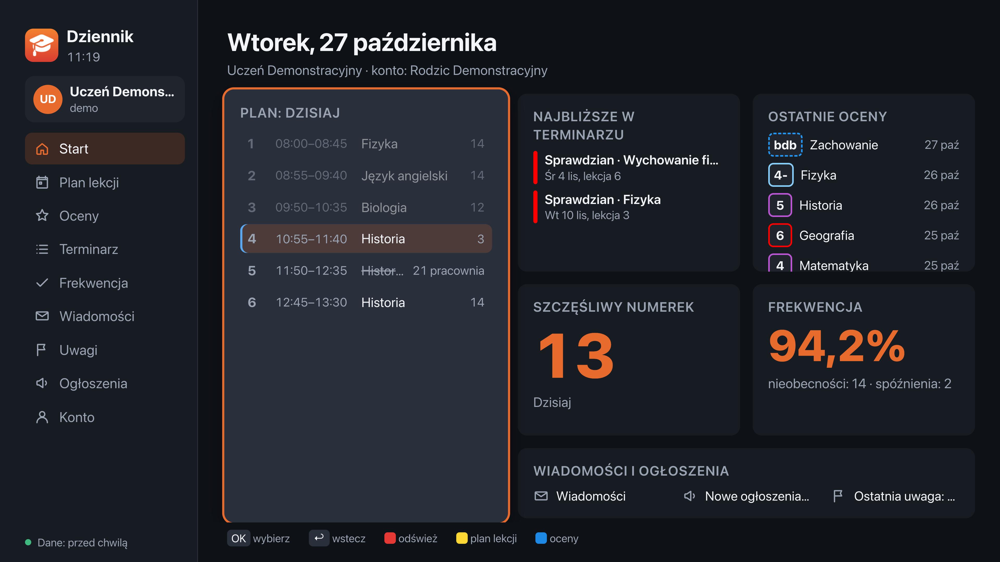
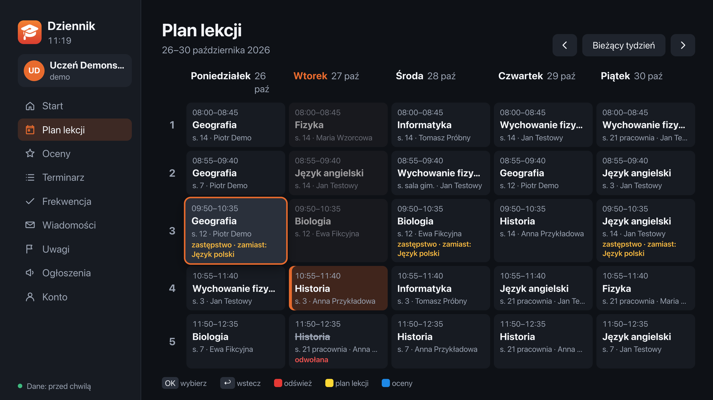
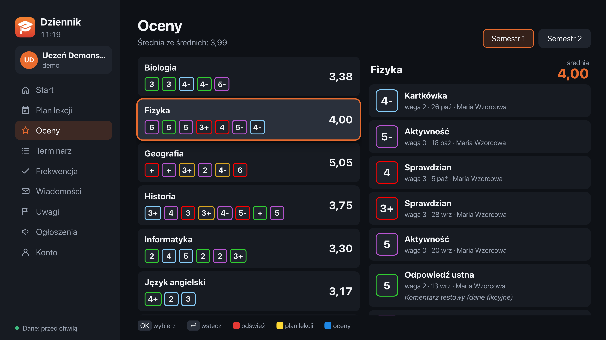
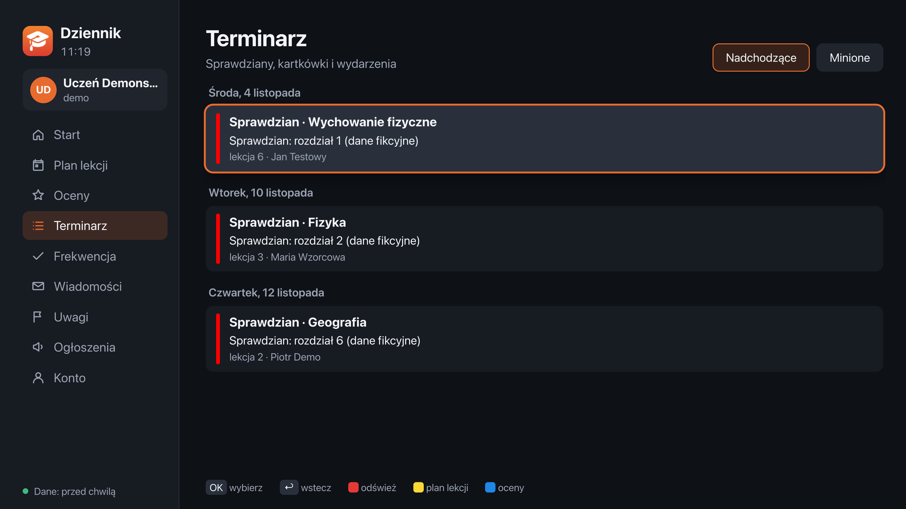
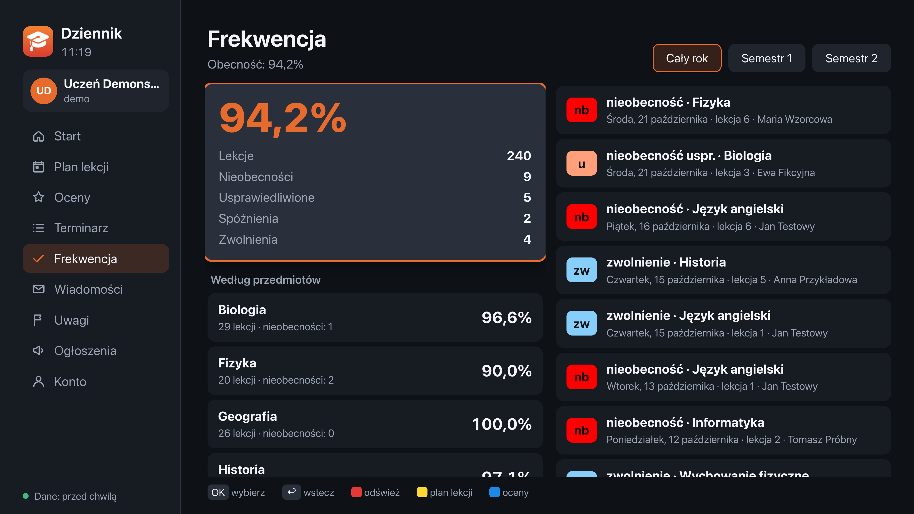
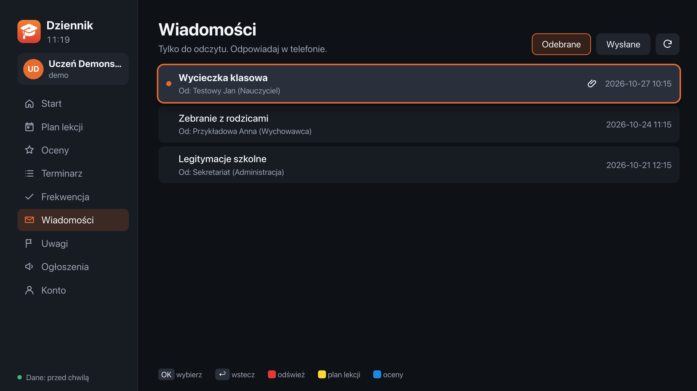
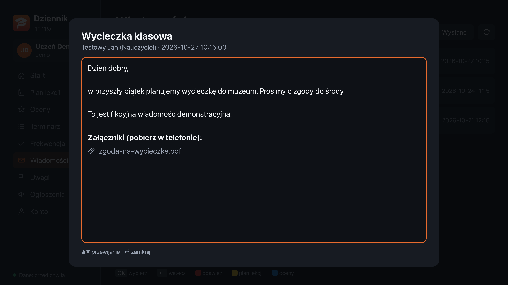
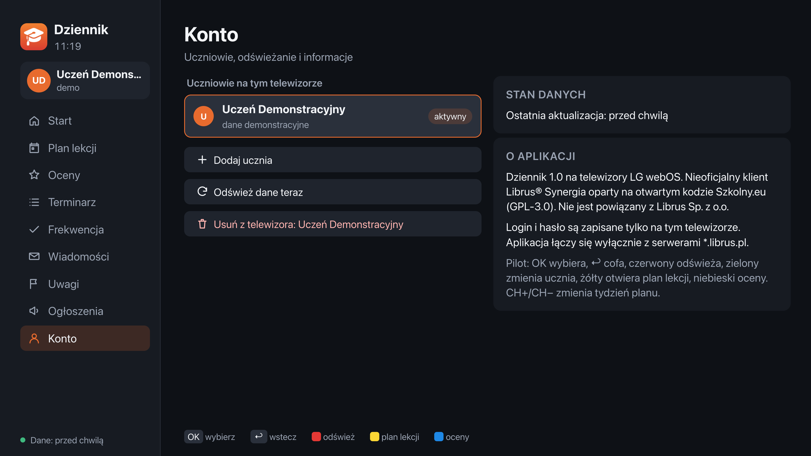
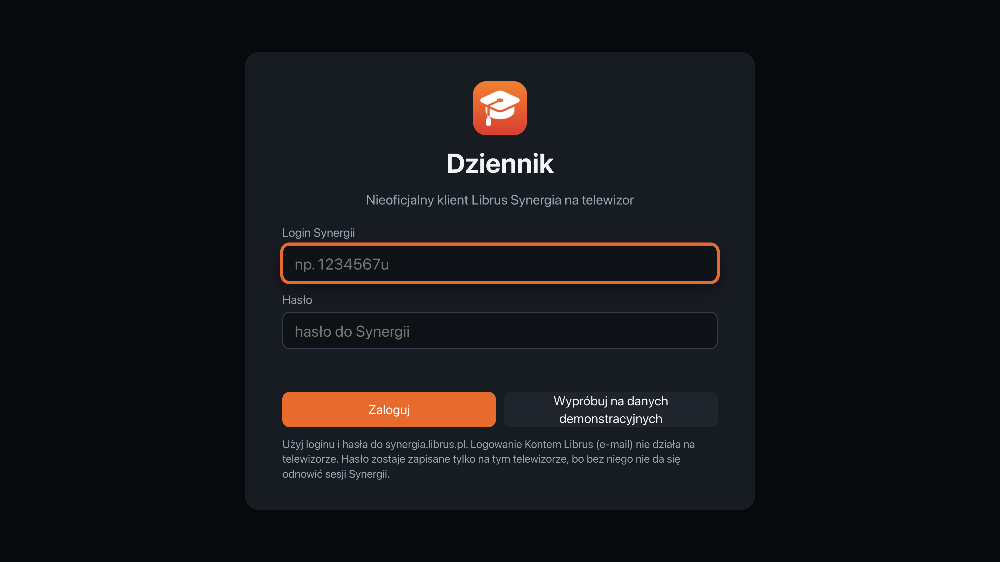

<div align="center">


# Dziennik na LG webOS

**Nieoficjalny klient Librus Synergia na telewizory LG. Port aplikacji [Szkolny.eu](https://github.com/szkolny-eu/szkolny-android)**


<br>



</div>

## Ważna informacja

Ta aplikacja **nie jest oficjalną aplikacją Librus** i nie jest powiązana z Librus Sp. z o.o., LG Electronics ani
z autorami Szkolny.eu. Korzysta z otwartego kodu [Szkolny.eu dla Androida](https://github.com/szkolny-eu/szkolny-android)
i obsługuje tylko dziennik **Librus® Synergia**.

Twórcy Szkolny.eu piszą, że **firma Librus zabroniła im** publikowania aplikacji z obsługą Librusa w Google Play.
Dlatego ta wersja **nie jest i nie będzie publikowana** w LG Content Store. Jest do instalacji na własnym telewizorze,
do prywatnego użytku. **Może przestać działać** po zmianach po stronie Librusa.

Telewizory LG działają na webOS, nie na Androidzie. Wersja na Android TV / Google TV:
[dziennik-androidtv](https://github.com/wadamczewski/dziennik-androidtv).

> [!NOTE]
> **Stan weryfikacji.** Sprawdzone: testy na fikcyjnych danych (12/12), logowanie na lokalnym fałszywym serwerze,
> działanie usługi w paczce (test z atrapą `webos-service`), wszystkie ekrany w przeglądarce 1920×1080 w trybie demo.
> **Nie sprawdzone:** uruchomienie na prawdziwym telewizorze (połączenie aplikacji z usługą przez magistralę luna)
> i logowanie na prawdziwym koncie (ścieżka logowania jest ta sama co w działającej wersji iOS).

## Zrzuty ekranu

Zrzuty w 4K (3840×2160) z podglądu aplikacji webOS (1920×1080, podwójna gęstość pikseli), w trybie demonstracyjnym. **Wszystkie dane na zrzutach są fikcyjne.**
Kliknij obrazek, żeby zobaczyć pełną rozdzielczość.

<table>
<tr><td width="50%"><a href="screenshots/02-start.png"></a><br><sub>Start: plan na dziś, szczęśliwy numerek, terminarz, oceny</sub></td><td width="50%"><a href="screenshots/03-plan-lekcji.png"></a><br><sub>Plan lekcji z zastępstwami i odwołanymi lekcjami</sub></td></tr>
<tr><td width="50%"><a href="screenshots/04-oceny.png"></a><br><sub>Oceny ze średnimi ważonymi</sub></td><td width="50%"><a href="screenshots/05-terminarz.png"></a><br><sub>Terminarz</sub></td></tr>
<tr><td width="50%"><a href="screenshots/06-frekwencja.png"></a><br><sub>Frekwencja</sub></td><td width="50%"><a href="screenshots/07-wiadomosci.png"></a><br><sub>Wiadomości</sub></td></tr>
<tr><td width="50%"><a href="screenshots/08-wiadomosc.png"></a><br><sub>Czytanie wiadomości</sub></td><td width="50%"><a href="screenshots/09-konto.png"></a><br><sub>Uczniowie i ustawienia</sub></td></tr>
<tr><td width="50%"><a href="screenshots/01-logowanie.png"></a><br><sub>Logowanie loginem Synergii</sub></td></tr>
</table>

## Funkcje

Aplikacja jest do **czytania** dziennika z kanapy i obsługuje się ją pilotem.

- **Start**: plan na dziś (bieżąca lekcja podświetlona), szczęśliwy numerek, najbliższe sprawdziany, ostatnie oceny, frekwencja
- **plan lekcji** całego tygodnia w siatce, z odwołanymi lekcjami, zastępstwami i przeniesieniami
- **oceny** ze **średnimi ważonymi** (jak w Szkolny.eu), podział na semestry, oceny przewidywane i końcowe, poprawy, komentarze
- **terminarz**: nadchodzące i minione sprawdziany, kartkówki, wydarzenia
- **frekwencja**: procent obecności, statystyki, podział na przedmioty, lista nieobecności i spóźnień
- **wiadomości** (odebrane i wysłane) do czytania na dużym ekranie
- **uwagi** i **ogłoszenia** szkolne
- **kilku uczniów** na jednym telewizorze i szybkie przełączanie
- działanie **offline**: ostatnio pobrane dane są widoczne od razu, odświeżanie w tle co 30 minut
- **tryb demonstracyjny** na fikcyjnych danych (przycisk na ekranie logowania)

**Pilot:** strzałki i OK, ↩ (Wstecz) wraca do menu, a z menu wychodzi z aplikacji. Kolorowe przyciski: 🔴 odśwież,
🟢 zmień ucznia, 🟡 plan lekcji, 🔵 oceny. CH+/CH− zmienia tydzień planu. Pilot Magic Remote (wskaźnik) też działa.

Czego nie ma: wysyłania wiadomości, pobierania załączników i logowania Kontem Librus (e-mail). Do tego służy telefon.

## Logowanie

Logujesz się **loginem i hasłem Synergii** (np. `1234567u`), tak jak na synergia.librus.pl.

Logowanie z oryginalnego Szkolny.eu (`api.librus.pl/OAuth/Token`, `grant_type=password`) już nie działa: Librus zwraca
`unsupported_grant_type`. Dlatego aplikacja loguje się przez formularz synergia.librus.pl (`client_id 46`, jak w
librus-apix), a dane pobiera z `synergia.librus.pl/gateway/api/2.0`.

Aplikacja webowa na telewizorze nie może sama tego zrobić: nie widzi ciasteczek z innych domen, nie kontroluje
przekierowań i podlega CORS. Dlatego logowanie i pobieranie danych robi **usługa JS (Node.js)** dołączona do paczki.
Usługa jest bezstanowa: przy każdym wywołaniu dostaje login, hasło i ciasteczka sesji, a zwraca przetworzone dane
i odnowione ciasteczka. webOS może ją w każdej chwili zatrzymać i nic się nie traci. Jest budowana pod Node.js 12
(webOS 22–23 ma Node.js 12, webOS 24–25 ma Node.js 16).

## Instalacja

Gotowa paczka: `pl.prywatny.dziennik_1.0.0_all.ipk` w [Releases](https://github.com/wadamczewski/dziennik-webos/releases/latest).
Możesz też zbudować ją sam (niżej). Zainstaluj ją jednym ze sposobów:

**A. Zrootowany telewizor z Homebrew Channel.** Podaj adres i klucz SSH w zmiennych środowiskowych, nie w plikach:

```bash
TV_HOST=adres-tv TV_SSH_KEY=~/.ssh/klucz ./tools/install-ssh.sh
```

Skrypt kopiuje `dist/*.ipk` przez SCP i instaluje go przez `luna://com.webos.appInstallService/dev/install`.
Potem sprawdza usługę aplikacji na telewizorze (synchronizacja na danych demonstracyjnych). Nie zmienia ekranu
głównego, skrótów pilota ani innych aplikacji. Jeśli pobrałeś paczkę z Releases, włóż ją do `dist/`.
Opcjonalnie: `TV_KNOWN_HOSTS=plik` wymusza sprawdzenie klucza hosta z prywatnego pliku `known_hosts`,
a `TV_LAUNCH=1` od razu uruchamia aplikację na telewizorze.

**B. Tryb dewelopera LG** (bez roota). Zainstaluj aplikację „Developer Mode” z LG Content Store, zaloguj się kontem
dewelopera LG, sparuj telewizor (`npx ares-setup-device`) i wykonaj:

```bash
npx ares-install dist/pl.prywatny.dziennik_1.0.0_all.ipk
```

Sesja trybu dewelopera wygasa i trzeba ją odnawiać w aplikacji Developer Mode.

Aplikacja „Dziennik” pojawi się na liście aplikacji telewizora.

## Kompilacja i testy

Potrzebny jest **Node.js 20+**.

```bash
npm install
```

```bash
npm run build        # dist/pl.prywatny.dziennik_1.0.0_all.ipk
```

```bash
npm test             # parsery, mapowanie błędów, logowanie na fałszywym serwerze (dane fikcyjne)
```

```bash
npm run dev          # podgląd w przeglądarce: http://localhost:8790 (okno 1920×1080, login „demo”)
```

```bash
npm run check-login  # sprawdza Twoje logowanie z komputera; wypisuje tylko liczby, hasło nie jest zapisywane
```

<details>
<summary>Struktura projektu</summary>

```
core/      logika: logowanie Synergii, API gateway, parsery, wiadomości (port Szkolny.eu)
service/   usługa webOS (Node.js), przez którą aplikacja łączy się z Librusem
ui/        interfejs na pilota (bundlowany do app.js przez esbuild)
app/       appinfo.json, HTML, CSS, ikony
tools/     build.mjs (.ipk), dev-server.mjs, check-login.mjs, install-ssh.sh
test/      testy (node --test)
fixtures/  fikcyjne odpowiedzi Librusa używane w testach
screenshots/ zrzuty ekranu do README (dane fikcyjne)
```

</details>

## Prywatność

- Aplikacja łączy się wyłącznie z `*.librus.pl`, nie z serwerami Szkolny.eu ani z innymi.
- **Hasło Synergii jest zapisywane**, bo bez niego nie da się odnowić sesji. Jest w pamięci aplikacji (localStorage)
  na telewizorze. webOS nie ma odpowiednika pęku kluczy, więc na zrootowanym telewizorze może je odczytać każdy,
  kto ma dostęp do roota.
- **Konto → Usuń z telewizora** kasuje login, hasło i pobrane dane ucznia.
- Dane w `fixtures/` i w trybie demo są fikcyjne. **Nie wklejaj w zgłoszeniach danych logowania, prawdziwych danych
  uczniów, adresów telewizora ani kluczy.**

## Gdy coś nie działa

- **„Nieprawidłowy login lub hasło”**: zaloguj się tymi samymi danymi na synergia.librus.pl. Konto Librus (e-mail)
  nie działa, potrzebny jest login Synergii.
- **„Librus odrzucił logowanie”** lub błędy API: Librus mógł zmienić logowanie. Kod jest w `core/session.js`.
- **Wiadomości się nie wczytują**: selektory HTML są w `core/synergia.js`.
- **„Service does not exist”**: paczka nie zainstalowała usługi. Przebuduj ją (`npm run build`) i zainstaluj ponownie.
- Część sekcji (np. szczęśliwy numerek) może być wyłączona w szkole. Wtedy jest pusta.

## Licencja

Dziennik, tak jak Szkolny.eu, jest publikowany na licencji [GNU GPLv3](LICENSE). Możesz modyfikować kod i dystrybuować
zbudowane wersje razem z kodem źródłowym, nie możesz zmieniać licencji ani informacji o prawach autorskich.
Za opracowanie komunikacji z Librusem odpowiadają autorzy [Szkolny.eu](https://github.com/szkolny-eu/szkolny-android).

Nazwy Librus®, LG® i webOS® są znakami towarowymi ich właścicieli. Używamy ich wyłącznie w celu wskazania, z czym
współpracuje aplikacja.

*Kod został przygotowany z pomocą AI. Przejrzyj go przed użyciem.*
